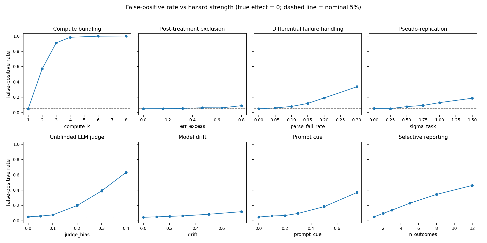

# How design hazards fake wins in LLM-agent experiments

A simulation study. When one design hazard slips into an experiment that compares two LLM agents (or prompts, or models), how far off is the estimated effect, and how often does the study report a "significant" improvement that does not exist?

All data are simulated: no model calls, no empirical dataset, $0 spend. The plan, configuration and code were frozen before the main sweeps (PLAN.md, with SHA-256 hashes in FREEZE_MANIFEST.txt); changes after the freeze are in PLAN.md's amendment log.

**Tool built from this study:** [Agent Eval Planner](https://omidgolchin.github.io/experiment-hazard-simulator/) ([code](https://github.com/omidgolchin/experiment-hazard-simulator)), which runs the same model on a visitor's own eval design before they run it.

## Model

Two conditions, A (control) and B (treatment), each on its own sample of T tasks with S attempts per task. Task difficulty varies on the logit scale (σ_task = 1); each attempt succeeds with probability sigmoid(base + difficulty + δ·B + noise). Defaults: 20 tasks, 5 attempts, baseline success 0.5, α = 0.05. The correct analysis treats the task as the replication unit (per-task means, Welch t). Each hazard is added one at a time, at a realistic strength and over a sweep of strengths; sweep points use 4,000 simulated experiments and headline numbers 10,000.

## Results

With no hazard, the false-positive rate is 0.050 at α = 0.05, as it should be, so departures belong to the hazards.

Each hazard alone, no real effect (δ = 0), 20 tasks × 5 attempts:

| Hazard | Setting | False-positive rate | Mean estimate | Check that catches it |
|---|---|---|---|---|
| Compute bundling (best-of-k for B only) | k = 3 | 0.912 | +0.300 | compute-matched arm |
| Selective reporting | best of 5 outcomes | 0.224 | +0.001 | pre-specified primary outcome + correction |
| Unblinded LLM judge | flips 20% of B's failures | 0.199 | +0.101 | blinded judging + judge validation |
| Prompt cue | demand effect 0.4 | 0.138 | +0.080 | matched wording |
| Differential failure handling | parse failures 15% | 0.129 | −0.075 | same failure rule in both arms |
| Pseudo-replication | naive pooled SE | 0.128 | +0.000 | replication unit = task |
| Model drift | shift 0.5 mid-block | 0.078 | +0.049 | interleave runs, pin the version |
| Post-treatment exclusion | 40% excess crashes on hard tasks | 0.053 | +0.022 | intention-to-treat |

- Two hazards together (best-of-3 plus a naive standard error) reach 0.973.
- Pseudo-replication is harmless when tasks are homogeneous (0.053 at σ_task = 0), the pre-specified null case.
- Dropping crashed hard tasks barely moves the false-positive rate: it costs power, not validity.
- Small agent studies also miss real effects: at 20 tasks the clean design detected a modest real effect (δ = 0.3) only 10% of the time (0.6: 25%).



Full tables, including every sweep with Monte Carlo standard errors: [results/summary.md](results/summary.md).

## Limitations

- Binary success per attempt; graded scores need a different model.
- One effect size and one baseline rate per setting; real improvements vary by task.
- Hazard strengths are illustrative; the study shows the mechanism and its scale, not how strong a hazard is in any particular evaluation.
- Integrity note: the simulation model itself (`sim/model.py`, `sim/hazards.py`), the configuration and the model tests still match their frozen hashes. `PLAN.md`, `sim/analyze.py`, `sim/js_check.mjs` and `tests/test_js_agreement.py` no longer do, and those later changes are not in the amendment log; the frozen versions were not kept. The current code regenerates the published results exactly.
- The JavaScript copy of the model (`sim/hazard_sim.js`) must agree with the Python model within Monte Carlo error on three documented settings (`tests/test_js_agreement.py`). The freeze manifest also lists the study's original interactive page (`docs/`); that page has since become the Agent Eval Planner and lives in the tool's repository, so those hashes no longer apply here.

## Reproduce

```bash
python3 -m venv .venv && .venv/bin/pip install -r requirements.txt
.venv/bin/python -m pytest tests -q   # model tests and JS agreement
.venv/bin/python -m sim.analyze       # regenerates outputs/, results/summary.md and the figure
```

## References

- Hurlbert, S. H. (1984). Pseudoreplication and the design of ecological field experiments. *Ecological Monographs*, 54(2), 187–211.
- Simmons, J. P., Nelson, L. D., & Simonsohn, U. (2011). False-positive psychology. *Psychological Science*, 22(11), 1359–1366.
- Panickssery, A., Bowman, S. R., & Feng, S. (2024). LLM evaluators recognize and favor their own generations. *NeurIPS 2024*.
- Zheng, L. et al. (2023). Judging LLM-as-a-judge with MT-bench and Chatbot Arena. *NeurIPS 2023*.

By Omid Golchin. MIT-licensed (LICENSE).
